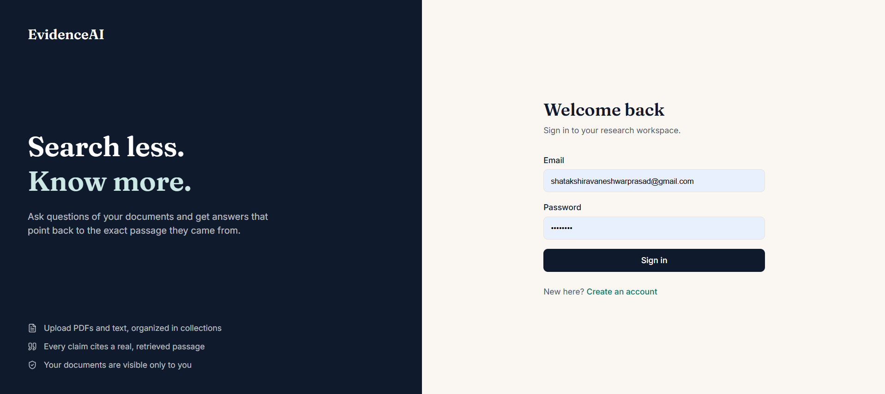
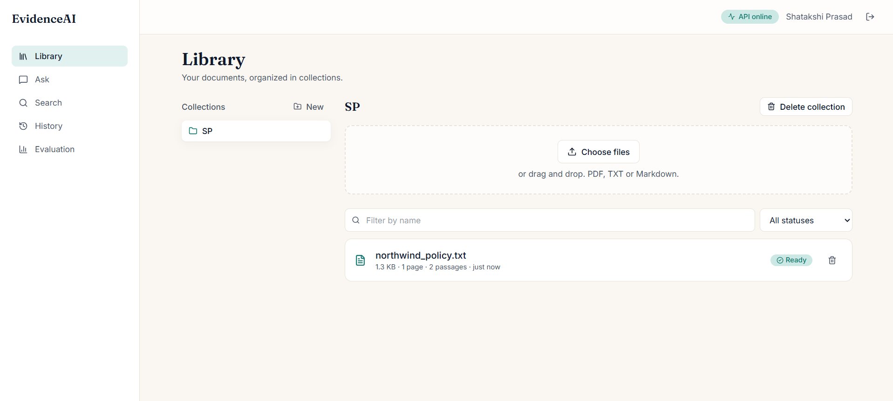
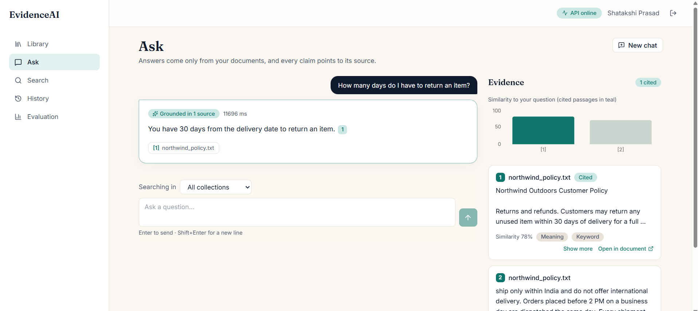
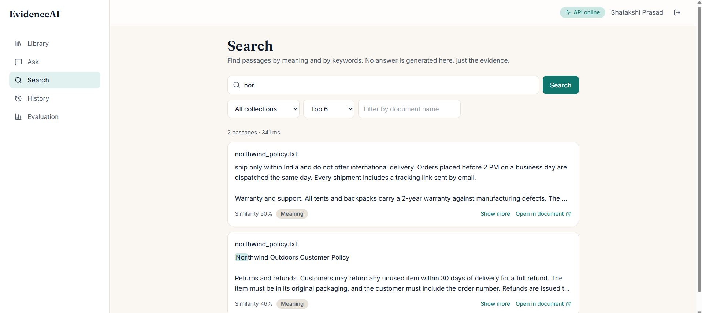
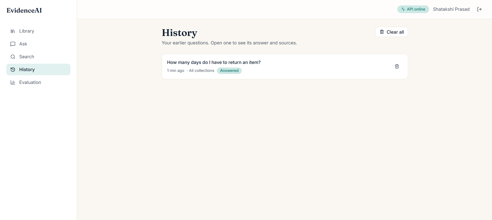
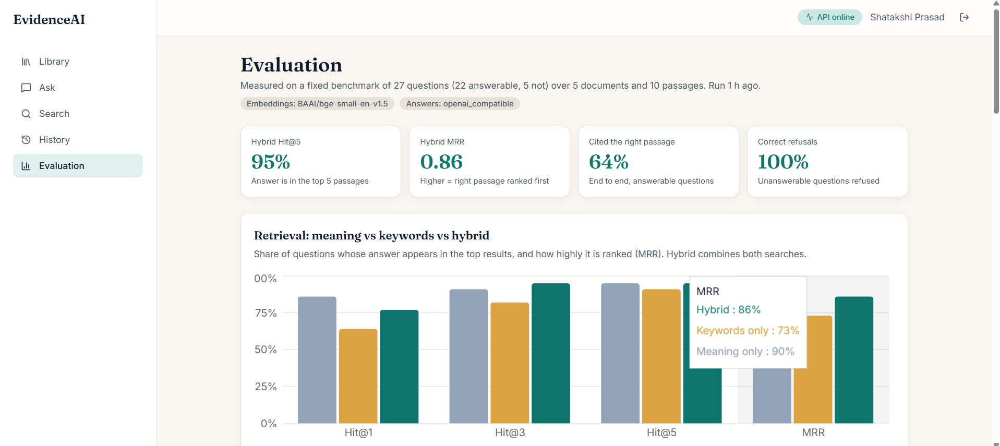
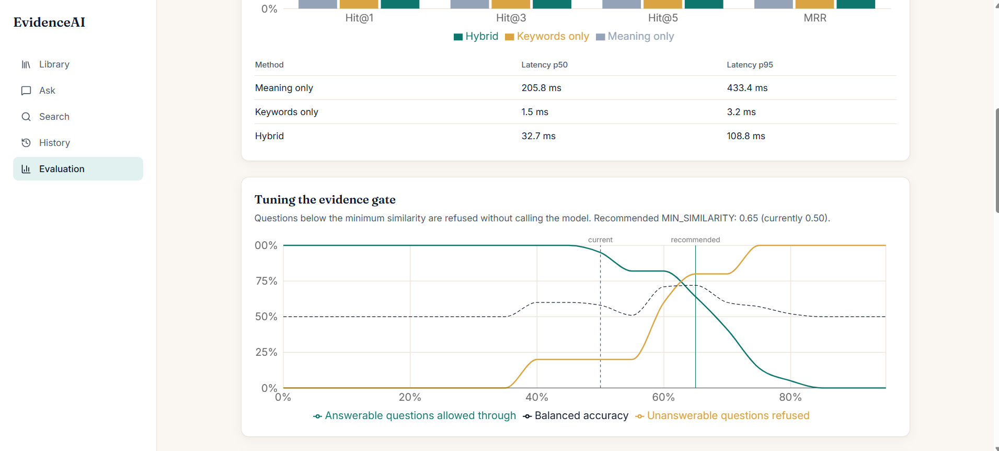
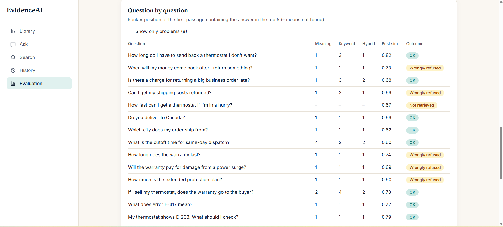

# EvidenceAI

**Search less. Know more.**

EvidenceAI is a document-intelligence web app. Upload PDFs, text and Markdown files, ask questions in plain language, and get answers where **every claim points to the exact passage it came from**. When your documents don't contain the answer, it says so instead of guessing.



## What it does

- **Cited answers only.** Each answer is built from retrieved passages, and citations like `[1]` are checked against what was actually retrieved. Invented citations are stripped before anything is shown.
- **Refuses when evidence is missing.** If no passage is similar enough, or the model says the sources are insufficient, the app answers "not enough evidence" rather than inventing something.
- **Hybrid search.** Meaning-based (vector) search and keyword search run together and are merged with Reciprocal Rank Fusion. A Search page shows the raw passages, highlighted terms and similarity scores, with no generated answer.
- **Built-in evaluation.** A fixed benchmark of 27 questions (22 answerable, 5 not) measures retrieval quality and answer behaviour, and the results are shown on an in-app Evaluation page.
- **Private by design.** Every query is scoped to the signed-in user, so one user can never see another user's documents (covered by tests).
- **Background processing.** Uploads are validated, de-duplicated, split into overlapping page-aware chunks, embedded and indexed by a separate worker, with retries and recovery for stuck jobs.

## Screenshots

### Library
Collections and uploaded documents, with processing status.



### Ask
A grounded answer with citations. The evidence panel shows every retrieved passage, which ones were cited, and how similar each was to the question.



### Search
Passages only, with highlighted matches, similarity scores, and whether each came from meaning or keyword search.



### History
Earlier questions, saved with their answers and sources.



### Evaluation
A fixed benchmark that compares meaning-only, keyword-only and hybrid retrieval, and shows how well the whole pipeline behaves.



The evidence gate (the minimum similarity needed before the model is called) is tuned against the benchmark rather than guessed:



Every benchmark question is listed with where its answer was ranked, so failures can be investigated instead of hidden:



## Benchmark results

Measured on a small fixed set: 27 questions over 5 fictional documents (10 passages), using `BAAI/bge-small-en-v1.5` embeddings and an OpenAI-compatible model.

| Retrieval | Hit@1 | Hit@3 | Hit@5 | MRR |
|---|---|---|---|---|
| Meaning only | 0.86 | 0.91 | 0.95 | 0.90 |
| Keywords only | 0.64 | 0.82 | 0.91 | 0.73 |
| Hybrid | 0.77 | 0.95 | 0.95 | 0.86 |

| End to end | Result |
|---|---|
| Unanswerable questions correctly refused | 100% (5 of 5) |
| Answerable questions answered with a cited passage | 64% (14 of 22) |
| Answers containing an invented citation | 0% |
| Answer support (heuristic) | 0.78 |

**How to read this honestly.** The set is small, so differences of a few points are noise. Meaning-only search ranks the right passage first more often than hybrid here; hybrid is ahead only at the top 3. The refusals are the strongest result: the system never answered a question its documents couldn't support.

### Known limitations

- 8 of the 27 questions are flagged as problems in the Evaluation page. Several answerable questions were refused even though the right passage was retrieved. I haven't yet determined how much of that comes from the similarity gate, the model returning "insufficient evidence", or free-tier rate limits during the run.
- The benchmark is a regression check, not a general accuracy claim.
- Latency numbers from the rate-limited free tier are not representative and are not reported here.

## Architecture

```
React + TypeScript (Vite)
        |  /api  (cookie session)
        v
FastAPI  ----------------------> Redis  (job queue)
   |  |                              |
   |  |                              v
   |  |                        Worker process
   |  |            (extract -> chunk -> embed -> save)
   v  v                              |
PostgreSQL + pgvector  <-------------+
 (users, collections, documents, chunks, vectors, keyword index, history)
```

A question flows like this: embed the question, run vector and keyword search, fuse the rankings, apply the similarity gate, send the numbered passages to the language model, then validate the citations in the reply against the passages.

## Tech stack

| Area | Tools |
|---|---|
| Backend | Python 3.12, FastAPI, Pydantic v2, SQLAlchemy 2.0, Alembic |
| Data | PostgreSQL with pgvector (384-dimension vectors) and full-text search, Redis |
| Auth and safety | Argon2 password hashing, JWT in httpOnly cookies, Origin checks, Redis rate limiting, upload validation by content, prompt-injection-safe source tags |
| ML | Sentence Transformers (`BAAI/bge-small-en-v1.5`), pluggable answer model (extractive, or any OpenAI-compatible API such as Groq, OpenAI or Ollama) |
| Frontend | React, TypeScript, Vite, Tailwind CSS, React Router, TanStack Query, Recharts |
| Testing | pytest (175 tests), Vitest and Testing Library (26 tests) |
| Delivery | Docker Compose, nginx, GitHub Actions (including a retrieval-quality gate) |

## Run it locally

You need Docker Desktop.

```bash
git clone https://github.com/shatakshi-1404/Evidence-ai.git
cd Evidence-ai
cp .env.example .env        # then set SECRET_KEY to a long random value
docker compose up --build
```

Open http://localhost:5173. The first start downloads the embedding model (about 130 MB), so give it a few minutes.

By default answers come from the extractive provider, which needs no API key. To use a real model, set these in `.env`:

```
LLM_PROVIDER=openai_compatible
LLM_BASE_URL=https://api.groq.com/openai/v1
LLM_API_KEY=your-key
LLM_MODEL=<a chat model your provider offers>
```

Then reload the settings with `docker compose up -d --force-recreate backend worker`.

Run the benchmark:

```bash
docker compose exec -e LLM_MAX_RETRIES=10 backend python -m app.evaluation.run
```

Run the tests:

```bash
cd backend && pip install -r requirements-dev.txt && pytest
cd frontend && npm install && npm test
```

## Deployment

`render.yaml` (a Render Blueprint) and `frontend/vercel.json` are included. See [DEPLOY.md](DEPLOY.md). The backend needs roughly 2 GB of RAM because of the embedding model.

## Project layout

```
backend/    FastAPI app, worker, migrations, evaluation, tests
frontend/   React app
docs/       screenshots
```
